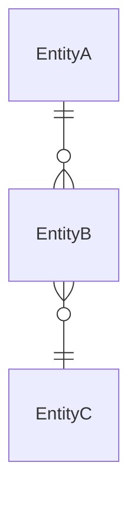

# Domain

> File này mỏng — chỉ chứa **shared vocabulary** và **shared entities** (entity ở mức vocabulary nghiệp vụ chung, dự kiến dùng bởi 2+ component; việc dùng-bởi-2+ và `Owner` được xác nhận ở pha thiết kế).
>
> Business rules, domain events, internal entities thuộc về component sở hữu — xem `.specs/main/component/{C-XXX}-{component-name}/crd.md`.

## Glossary

Định nghĩa các thuật ngữ business — đây là **nơi duy nhất** chứa glossary trong toàn dự án.

| Term | Definition | Example / Context |
| --- | --- | --- |
| {term} | {định nghĩa chính xác, không mơ hồ} | {context hoặc ví dụ minh họa nếu cần} |

## Shared Entities

Entity ở mức vocabulary nghiệp vụ chung. Hai phần thông tin tới từ hai pha (xem two-phase cascade, `01-architecture.md` §7):
- **Định nghĩa** (tên, attributes, state machine) — *mô tả hệ thống* (WHAT): seed bởi `/spec-prd`/`/spec-frd`/`/spec-new`.
- **`Owner` / `Used by`** — *thiết kế hệ thống* (HOW): gán bởi `/spec-sad` (hoặc `/spec-new` khi carve component). Khi entity vừa được seed mà component chưa carve → để `Owner: TBD`.

Entity rõ ràng nội bộ một component (không phải vocabulary chung) không vào đây — chúng nằm trong `crd.md` của component đó.

**Entity ID (`E-XXX`):** mỗi shared entity được cấp một ID tuần tự khi seed lần đầu, theo thứ tự được thêm vào file này.
- ID tiếp theo = `id_counters.entity + 1` (frontmatter); cấp xong tăng `id_counters.entity`. Counter là **high-water-mark** (chỉ tăng, không giảm khi remove) → entity đã `[REMOVE]` vẫn giữ chỗ ID của nó mà không cần bản ghi trong doc.
- ID **không bao giờ tái sử dụng** và **không đánh lại** khi entity bị remove hoặc đổi tên.
- Reference từ artifact khác (frd/crd/spec/tech) dùng dạng `E-XXX {Entity Name}`.

### E-XXX {Entity Name}

**Owner:** `{C-XXX}-{component-name}` *(component sở hữu canonical definition; `TBD` nếu chưa carve — `/spec-sad` điền)*

**Used by:** `{C-XXX}`, `{C-YYY}` *(các component reference entity này; `TBD` cho tới khi gán Owner)*

{Mô tả entity này đại diện cho cái gì trong business context.}

**Attributes:**

| Attribute | Type | Required | Validation |
| --- | --- | --- | --- |
| {tên} | {business type} | Yes/No | {rule} |

Type là business type (text, number, money, date, email, phone) — không phải DB type.

**State Machine:** *(bỏ nếu entity không có lifecycle)*

| From | To | Trigger | Guard |
| --- | --- | --- | --- |
| {state} | {state} | {sự kiện} | {điều kiện} |

## Entity Relationships

Quan hệ giữa các shared entities. Quan hệ giữa entity nội bộ component thuộc về `cdd.md` của component đó.

