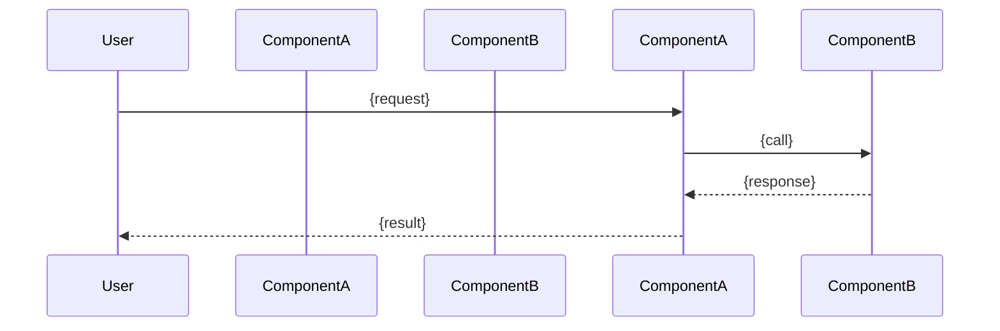

# Feature Design: {Feature Name}

> File này mỏng — chỉ mô tả **cách các component tương tác với nhau** để thực hiện feature.
>
> Internal design của từng component nằm trong `cdd.md` của component đó. Cross-cutting concerns nằm trong `sad.md`.

## Inter-Component Data Flow

Luồng dữ liệu đi qua các component — sequence diagram là form chính, có thể bổ sung mô tả prose.

{Mô tả ngắn các bước nếu sequence diagram chưa đủ rõ.}

## Orchestration

Logic ở cấp feature — không thuộc component nào riêng lẻ. Bỏ section nếu feature đơn giản (1-2 component, không cần retry/fallback đặc biệt).

| Concern | Handling |
| --- | --- |
| Retry policy | {ví dụ: retry 3 lần với exponential backoff khi gọi component X} |
| Timeout | {ví dụ: timeout tổng feature 5s; per-component 2s} |
| Fallback | {ví dụ: nếu component X fail, dùng cached data} |
| Error propagation | {ví dụ: lỗi từ component Y được map thành 503 cho user} |

## Cross-Component Invariants

Các invariant cần đảm bảo xuyên component — consistency, transactional boundary, ordering. Bỏ section nếu không có.

- {ví dụ: Order chỉ được đánh dấu `paid` sau khi Payment component confirm thành công}
- {ví dụ: Inventory phải được reserve trước khi Order được tạo, rollback nếu Payment fail}

## Verification Implementation

Map mỗi rule trong `frd.md > Verification Rules` sang implementation strategy ở cấp inter-component. Section này KHÔNG chứa internal detail của validation (regex cụ thể, validator library, error code) — những thứ đó thuộc về `cdd.md` của component sở hữu logic. Section này chỉ trả lời: rule chạy **ở đâu** trong flow, do component nào enforce, và lỗi propagate ra sao.

Bỏ section nếu feature không có Verification Rules.

| Rule ID | Rule (short) | Layer | Owning component | Error propagation |
| --- | --- | --- | --- | --- |
| `VR-F001-001` | username 3-20 ký tự, alphanumeric + `_` | client + gateway | `{C-XXX}-api-gateway` | 400 `INVALID_USERNAME` → UI inline error |
| `VR-F001-002` | username unique | service | `{C-YYY}-user-service` | 409 `USERNAME_TAKEN` → UI inline error |
| `VR-F001-003` | password ≥ 8 ký tự, có chữ hoa + số | client + gateway | `{C-XXX}-api-gateway` | 400 `WEAK_PASSWORD` → UI inline error |

Quy ước:
- **Rule ID**: reference tới `VR-F{NNN}-{seq}` trong `frd.md > Verification Rules`. ID là source of truth — nếu lệch giữa FRD và FDD, FRD đúng.
- **Rule (short)**: copy ngắn gọn từ FRD để row tự đọc được, không phải nhảy file. Nếu rule dài → giữ short ở đây, full description ở FRD.
- **Layer**: `client` (UI validation trước submit), `gateway` (API gateway / request validator), `service` (business logic component), hoặc kết hợp (`client + gateway` cho double-check). Layer ảnh hưởng UX (inline vs server round-trip).
- **Owning component**: component nào chịu trách nhiệm enforce. Implementation chi tiết (regex, validator code, error class) nằm trong `cdd.md` của component đó.
- **Error propagation**: HTTP status + error code semantic + cách render cho user. Wording cụ thể của error message thuộc UI copy artifact, không ở đây.

