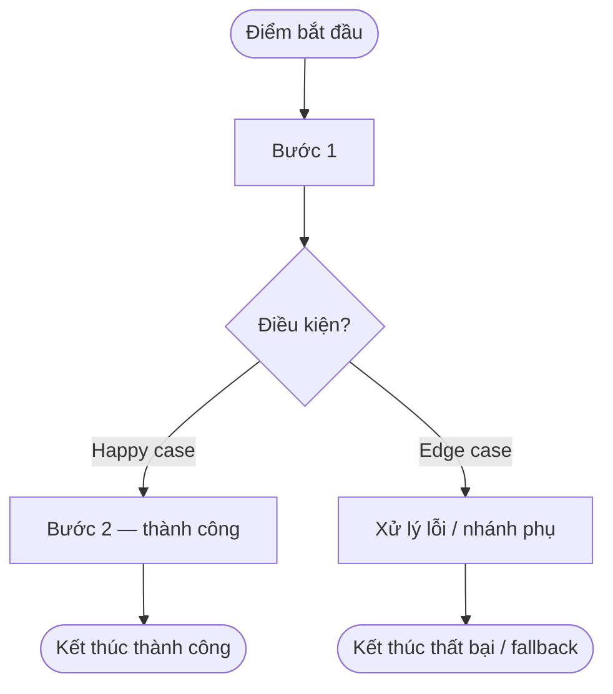
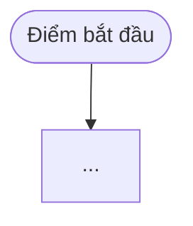

<!--
Canonical format cho feature/{F-XXX}-{slug}/frd.md.
spec.md và tech.md REFERENCE template này khi sinh Changes block — KHÔNG duplicate skeleton.
Mọi thay đổi structure ở file này tự động propagate qua Changes blocks vì chúng dùng đây làm format gốc.
-->

# Feature: {Feature Name}

## Overview

{Mô tả feature này giải quyết vấn đề gì cho user nào, trong 2-3 câu.}

## User Flows

{Mô tả các luồng thao tác của user để hoàn thành mục tiêu của feature này.}
{Mỗi flow là một Mermaid flowchart riêng, bao gồm happy case và tất cả edge cases quan trọng.}

Flow numbering **stable** — không renumber khi xóa flow. Nếu xóa Flow 1, Flow 2 giữ nguyên số (không tái sử dụng số 1). Số kế = `id_counters.flow + 1` (frontmatter), cấp xong tăng counter; counter là high-water-mark (không giảm khi xóa) nên số đã dùng không cấp lại.

### Flow 1: {Tên luồng chính}

### Flow 2: {Tên luồng phụ / edge case lớn} *(nếu có)*

## Feature Acceptance Criteria

Criteria **end-to-end** áp cho toàn feature mà Story AC lẻ không cover được — verify sự **kết nối giữa các phần** (emergent), không phải behavior từng story. Mọi Feature AC phải test được pass/fail.

Gồm 3 shape (đều functional, scope rộng):
- **Journey (liên story)** — full happy path đi *tuần tự* qua nhiều story trong 1 session; verify state persist + không đứt giữa các bước.
- **Consistency (đa màn)** — UI/behavior đồng nhất khi *so* nhiều màn trong feature với nhau.
- **Integrity (bất biến liên story)** — business invariant phải đúng khi *kết hợp* nhiều story, **không nhất thiết theo trình tự** (vd: xóa account → cascade xóa mọi order ở mọi module; tổng/đối soát khớp sau nhiều thao tác). Verify *trạng thái nhất quán cuối cùng*, không phải hành trình tuần tự — đây là nhà cho cross-story functional rule mà journey/consistency không ôm.

> NFR (performance, a11y, security, browser, i18n) và Data & Migration **KHÔNG** thuộc đây — chúng có section riêng bên dưới (khác type / execution-mode).
> Out of scope: release readiness (runbook/rollout/legal sign-off) và success metric/KPI post-release — đặt ở artifact khác (`tech.md`, `sad.md`, hoặc PMO checklist).

Feature AC ID format: `FAC-F{NNN}-{seq}` — counter **độc lập** với Story AC (`AC-F{NNN}-{seq}`). ID **stable** — không tái sử dụng seq khi xóa, không renumber. Seq kế = `id_counters.fac + 1` (frontmatter), cấp xong tăng counter (high-water-mark, không giảm khi xóa).

Format: **Given/When/Then bắt buộc** — kể cả consistency. **Then phải đo được**: ngưỡng cụ thể HOẶC danh sách item so sánh.

- `FAC-{F_ID}-001`
  - **Given** {precondition đo được}
  - **When** {action}
  - **Then** {outcome có threshold hoặc danh sách cụ thể, không vague}

## Non-Functional Requirements

<!-- Required-emptyable: GIỮ heading; để trống (không bullet) nếu feature không có NFR riêng ngoài bar chung của PRD. -->

NFR áp cho feature — **non-functional type** (performance, accessibility, security, browser support, i18n). Khác Feature AC ở chỗ verify *chất lượng dưới điều kiện*, không phải *làm đúng việc*.

> **Security — phân biệt rõ type:** access-control / authz rules ("role X không được thấy/làm Y") là **functional** → đặt ở Story AC hoặc Verification Rules, KHÔNG vào đây. Chỉ phần **non-functional** của security (pentest, vulnerability scan, security posture / hardening — verify bằng scanner, không phải walk UI) mới là NFR.

Quan hệ với PRD: mỗi NFR **tham chiếu `NFR-*` của PRD nếu có thể** (refine/siết bar chung cho feature này); nếu là yêu cầu **đặc thù-feature** mà PRD không có → đứng độc lập (không ref).

NFR ID format: `NFR-F{NNN}-{seq}` — counter độc lập. ID **stable** — không tái sử dụng seq khi xóa, không renumber. Seq kế = `id_counters.nfr + 1` (frontmatter), cấp xong tăng counter (high-water-mark). Format **Given/When/Then bắt buộc**, **Then đo được** (ngưỡng cụ thể).

- `NFR-{F_ID}-001` *(refines `NFR-P01` — nếu có)*
  - **Given** {điều kiện đo được — vd: 100 RPS sustained 5 phút}
  - **When** {action}
  - **Then** {ngưỡng cụ thể — vd: p95 ≤ 500ms, error rate ≤ 0.1%}

## Data & Migration

<!-- Required-emptyable: GIỮ heading; để trống (không bullet) nếu feature không đụng migration / backfill data cũ. -->

Yêu cầu về **dữ liệu cũ qua nâng cấp** — backfill, schema migration, không mất/hỏng data hiện hữu. Functional-type nhưng execution-mode riêng (chạy migration trên dataset, không phải UI flow).

DM ID format: `DM-F{NNN}-{seq}` — counter độc lập. ID **stable** — không tái sử dụng seq khi xóa, không renumber. Seq kế = `id_counters.dm + 1` (frontmatter), cấp xong tăng counter (high-water-mark). Format **Given/When/Then bắt buộc**, **Then đo được** (đếm bản ghi / so khớp cụ thể).

- `DM-{F_ID}-001`
  - **Given** {dataset cũ đo được — vd: 10.000 bản ghi địa chỉ format cũ}
  - **When** {chạy migration}
  - **Then** {kết quả đo được — vd: 10.000/10.000 đọc được, 0 bản ghi null, count khớp trước/sau}

## User Stories

US ID format: `US-F{NNN}-{seq}` — đánh số tăng dần toàn feature. ID **stable** — không tái sử dụng seq khi xóa, không renumber. Seq kế = `id_counters.us + 1` (frontmatter), cấp xong tăng counter (high-water-mark).

Story AC ID format: `AC-F{NNN}-{seq}` — đánh số tăng dần toàn feature (không reset giữa các story). ID **stable** — không tái sử dụng seq khi xóa, không renumber. Seq kế = `id_counters.ac + 1` (frontmatter), cấp xong tăng counter (high-water-mark).

**Luật cứng — AC chỉ mô tả backend là US CHƯA XONG.** Bộ AC dạng "tạo record X, gửi thông báo Y, đổi trạng thái Z" bỏ trống đúng ba câu mà người dùng cần, và mỗi câu bỏ trống là một vòng sửa sau khi đã báo xong:

1. **Entry point** — người dùng bấm từ đâu: màn nào, mục menu nào, permission nào gate mục menu đó. Deep-link trong notification **KHÔNG tính** là entry point (bỏ lỡ được, và không phủ hết nguồn dữ liệu sinh ra bản ghi).
2. **Đường tìm lại** — người xử lý tìm bản ghi bằng cách nào nếu bỏ lỡ thông báo. Có bản ghi mà không có màn danh sách = bản ghi mồ côi.
3. **UI phản ánh trạng thái** — mỗi AC đổi trạng thái phải có AC anh em nói màn hình đổi ra sao. Workflow có duyệt thì bắt buộc kèm bảng **trạng thái DB × nhãn người dùng thấy × hành động còn lại**; trạng thái DB **cố ý không đổi** (vd bản ghi giữ nguyên tới khi phiếu được duyệt) thì càng phải khai cờ riêng cho FE, nếu không nút cũ vẫn mời bấm và đẻ bản ghi trùng.

Ba câu này cũng là thứ `/review-integration` soi trước khi đóng.

### US-{F_ID}-001: {Story title}

**{Persona}** muốn **{hành động}** để **{mục tiêu}**.

**Priority:** Must / Should / Could

**Acceptance Criteria:**

- `AC-{F_ID}-{seq}`
  - **Given** {precondition}
  - **When** {action}
  - **Then** {expected outcome}
- `AC-{F_ID}-{seq}`
  - **Given** {precondition}
  - **When** {action}
  - **Then** {expected outcome}

---

### US-{F_ID}-002: {Story title}

**{Persona}** muốn **{hành động}** để **{mục tiêu}**.

**Priority:** Must / Should / Could

**Acceptance Criteria:**

- `AC-{F_ID}-{seq}`
  - **Given** {precondition}
  - **When** {action}
  - **Then** {expected outcome}

---

## Verification Rules

Constraint logic áp dụng cho input/data của feature — derive từ các input action mô tả trong User Stories ở trên. Pure WHAT, không chứa UI copy (error message, hint message thuộc về presentation, đặt ở artifact khác).

VR ID format: `VR-F{NNN}-{seq}` — đánh số tăng dần toàn feature (không reset theo field). ID **stable** — đã assign rồi giữ nguyên kể cả khi rule bị xóa (không tái sử dụng seq, không renumber). Seq kế = `id_counters.vr + 1` (frontmatter), cấp xong tăng counter; counter là high-water-mark (không giảm khi xóa rule) nên seq đã retire không cấp lại.

Quy ước:
- **ID**: `VR-F{NNN}-{seq}` — stable identifier để FDD và test plan reference.
- **Type**: semantic type, không phải concrete tech type. Dùng `string`, `number`, `integer`, `boolean`, `date`, `datetime`, `email`, `url`, `enum<A|B|C>`, `array<T>`. KHÔNG dùng `varchar(255)`, `int32`, v.v. — đó là HOW.
- **Required**: `yes` / `no` — field bắt buộc hay optional. Product quyết định.
- **Rule**: diễn đạt human-readable. KHÔNG viết regex/code cụ thể (đó là HOW, thuộc `fdd.md`). Một field có thể có nhiều rules → mỗi rule một dòng, mỗi dòng 1 ID riêng.
- **Refs**: link tới US/AC yêu cầu rule này. **Bắt buộc non-empty** — mỗi VR phải trỏ tới ít nhất một `US-*` hoặc `AC-*` **trong chính `frd.md` này**. VR không neo được vào story nào ⇒ ghi `NEEDS_CLARIFY`, **không** ghi row vào bảng: row có `Refs` rỗng không có đường nào đi vào build (`/plan` dựng `Definition of Done` và `/implement` trừ tập coverage đều **lọc** theo `Refs`, dây đứt thì chúng không báo lỗi mà chỉ lọc VR đó ra mất), lại trông như đã được xử lý. Kiểm bằng `npx spec-lite check-vr-refs <frd.md>`.

Sub-rule phức tạp (vd: password complexity với nhiều điều kiện) → **tách flat** thành nhiều rules riêng biệt, mỗi cái 1 ID, không hierarchy.

| ID | Field | Type | Required | Rule | Refs |
| --- | --- | --- | --- | --- | --- |
| `VR-{F_ID}-001` | `{field_name}` | `{semantic_type}` | yes / no | {rule diễn đạt human-readable} | `US-{F_ID}-{seq}` |

## Scope

### In Scope

- {những gì feature này làm}

### Out of Scope

- {những gì liên quan nhưng không làm — lý do}

## Dependencies

### Feature Dependencies

| Feature | Loại | Ghi chú |
| --- | --- | --- |
| {feature-name} | required before / parallel | {lý do} |

### Components Used

Tham chiếu đến `.specs/main/component/{C-XXX}-...`.

| Component | Vai trò trong feature |
| --- | --- |
| `{C-XXX}-{component-name}` | {component này phục vụ cái gì cho feature này} |

## Open Questions

<!-- Các câu hỏi cần làm rõ trong interview / với stakeholder trước khi proceed.
     Cũng dùng để note component candidate chưa carve (xem skills/spec-frd).
     Section required-emptyable: GIỮ heading; để trống (không có bullet) nếu không còn câu hỏi nào. -->

- [ ] {câu hỏi cần clarify} — {ai trả lời / khi nào}

