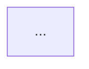

# System Architecture Document

## Architectural Style

{Monolith / Microservices / Event-driven / ...} — lý do chọn.

## System Overview

Các component chính và mối quan hệ giữa chúng.

### Components

Liệt kê các component của hệ thống — projection từ `prd.md > Components` với góc nhìn **architectural** (boundary, deployment unit, key tech concern). Vai trò business/role chi tiết xem `crd.md`, internal design xem `cdd.md`.

| ID | Component | Boundary / Architectural notes |
| --- | --- | --- |
| C-XXX | {name} | {deployment unit, layer, key tech-level concern} |

## Tech Stack

| Layer | Technology | Lý do chọn |
| --- | --- | --- |
| Frontend | {tech} | {lý do} |
| Backend | {tech} | {lý do} |
| Database | {tech} | {lý do} |
| Infrastructure | {tech} | {lý do} |

## Cross-Cutting Concerns

Các quyết định kỹ thuật áp dụng xuyên suốt toàn hệ thống — mọi feature/service đều phải tuân theo. Quyết định một lần tại đây thay vì để từng feature tự diễn giải.

- **Authentication & Authorization:** {strategy}
- **Error Handling:** {pattern}
- **Logging & Monitoring:** {approach}
- **Caching:** {strategy}

## Inter-Service Communication

*(Diagram tùy chọn — hữu ích khi số lượng service ít)*

| From | To | Method | Protocol | Notes |
| --- | --- | --- | --- | --- |
| {source} | {target} | sync/async | REST/event/gRPC | {ghi chú} |

## Infrastructure Overview

{Môi trường (dev/staging/prod), deployment strategy, provider.}

## Architectural Guardrails

Các nguyên tắc sau là bất biến. Agent phải kiểm tra compliance trước khi finalize `tech.md`.

- GUARD-001: {nguyên tắc — ví dụ: Không dùng raw SQL, phải qua ORM}
- GUARD-002: {nguyên tắc — ví dụ: Mọi external API call phải có retry + timeout}
- GUARD-003: {nguyên tắc — ví dụ: Không để business logic trong API layer}

## ADR Log

Architecture Decision Records — ghi lại các quyết định kiến trúc quan trọng cùng bối cảnh và hệ quả. Nắm *tại sao* chọn (điều mà Guardrails và Tech Stack không giải thích), giúp người sau hiểu trade-off thay vì đoán lại. Mỗi quyết định lớn (chọn style, tech chính, đánh đổi đáng kể) nên có một entry.

**Cấp ID (`ADR-nnn`):** ID kế tiếp = `id_counters.adr + 1`; cấp xong tăng `id_counters.adr` (frontmatter). ID **stable** — không tái sử dụng khi ADR `deprecated`/`superseded`, không renumber.

| ID | Decision | Status | Context & Rationale | Consequences |
| --- | --- | --- | --- | --- |
| ADR-001 | {quyết định ngắn gọn} | proposed / accepted / deprecated / superseded | {bối cảnh + lý do chọn, các option đã cân nhắc} | {hệ quả, đánh đổi phải chấp nhận} |

