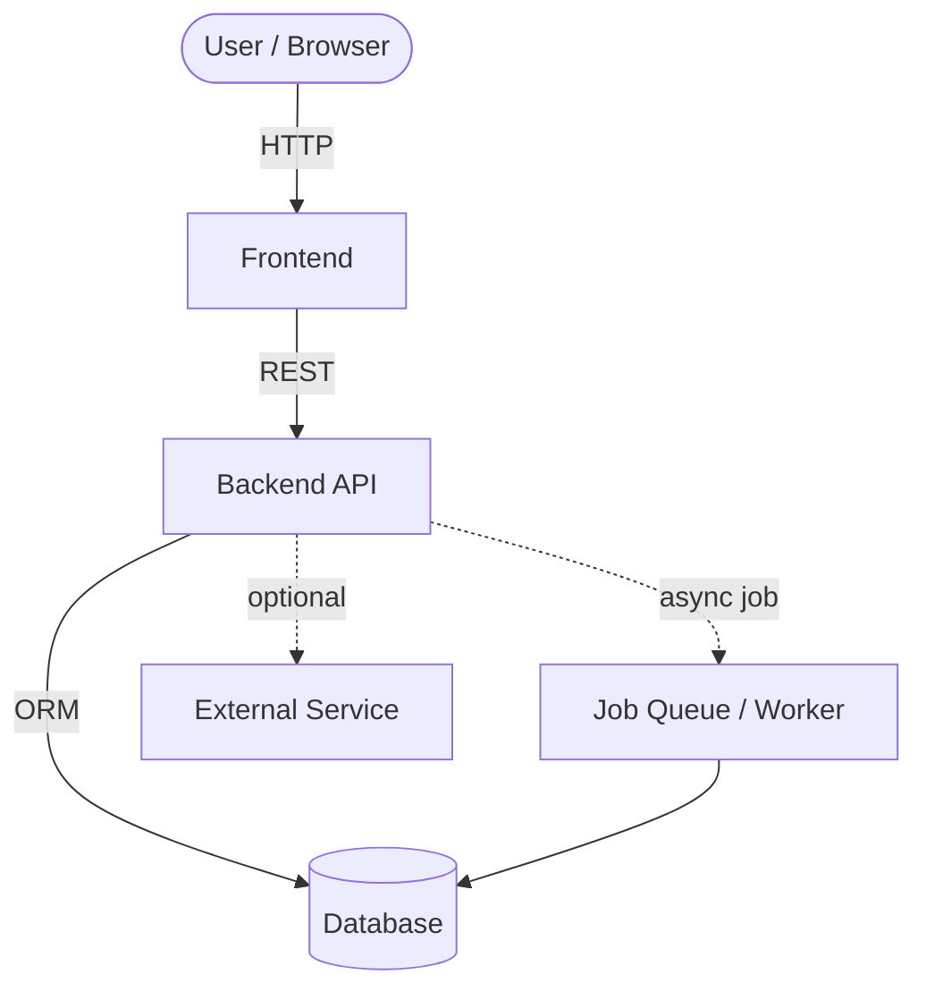

<!--
Canonical format cho .specs/tests/{F-XXX}-{slug}/test-exec-e2e.md.
EXECUTION layer — bền (015: 1 file/feature, ghi đè tại chỗ, history=git). Harness "Playwright / browser automation" (100% auto —
không còn bản manual), owner DEV. Cover Feature Acceptance Criteria (FAC) end-to-end — journey /
consistency / integrity.

E2E = SCOPE (FAC qua integration boundary), KHÔNG phải "Playwright". File này render scope đó bằng
automation — harness duy nhất (đã bỏ phân biệt manual/auto).
  - Inherit TC-F{NNN}-{seq} từ test-design. Tiêu đề test trong code PHẢI mở đầu bằng TC ID đó để
    runner filter được (test-core §2b) — KHÔNG đặt một hệ tên riêng cho code.
  - E2E verify BUSINESS OUTCOME qua integration boundary (UI→API→DB).

KHÔNG versioned: không template_version / migrations, ngoài scope /artifact-audit + /artifact-migrate.
Derived từ test-design.md → test-design đổi thì REGENERATE.

Source of truth: test-design.md > E2E Test Cases.
  - ID artifact = TC-F{NNN}-{seq} inherit từ test-design (Covers FAC-F*). KHÔNG tạo ID mới.
  - Cột "Tiêu đề test" ghi tiêu đề CÓ THẬT trong *.spec.ts, không ghi tên dự kiến.
  - Coverage master = test-design.md > Traceability Matrix.

E2E phải verify BUSINESS OUTCOME qua integration boundary (UI→API→DB), không chỉ UI state.
  UI State:         "Success toast visible"                              ← chưa đủ
  Business Outcome: "Record tồn tại trong DB, hiện trên list, count = N" ← bắt buộc [verify-db]/[verify-api]

KHÔNG chứa KẾT QUẢ. Doc này là spec của test code (persona/steps/outcome/POM). Result (pass/fail
per-TC) sống ở test-report.md của bundle — NƠI DUY NHẤT giữ kết quả (013 §4).

PLATFORM (frontmatter `platform`) quyết định harness + convention của toàn bộ file:
  - `web`   → Playwright, Page Object Model, `data-testid`/`getByTestId`, `page.request` cho verify-api.
  - `mobile` → Maestro (flow YAML, black-box qua Semantics Tree — KHÔNG có DOM/HTTP client trong tay).
    Không có POM (§7.1 chỉ liệt kê flow/subflow files). Testid = `Semantics(identifier:)` ↔ `id:` trong
    flow, khai trong file GLOBAL `.maestro/selector-contract.md` (một file/toàn app, KHÔNG per-feature —
    khác quy ước web). Business outcome verify qua bước kế tiếp của chính flow (UI phản ứng sau khi app
    gọi API thật) hoặc một flow riêng dùng lại (vd flow login để chứng minh tài khoản đã bị vô hiệu),
    KHÔNG qua `page.request`. Mỗi feature/skill chọn ĐÚNG MỘT platform — không trộn trong cùng file.
-->

# E2E Test Specification (Automation): {Feature Name}

**Feature**: {F-XXX} | **Owner**: {owner} | **Reviewer**: {reviewer} | **Status**: {status}

---

## 1. Context

| **Field** | **Detail** |
|---|---|
| **Feature Summary** | {2–3 câu từ frd.md Overview} |
| **FAC covered** | {FAC IDs — `FAC-F{NNN}-001`, ...} |
| **E2E Purpose** | Verify business outcome + integration point — không chỉ UI behavior |
| **Method** | web: automation — Playwright, Page Object Model, real seeded backend (no API mocking) · mobile: automation — Maestro flow trên APK/IPA đã compile, real seeded backend, no mocking |
| **NOT in E2E Scope** | Validation format/length đơn lẻ (→ test-exec-validation) · Story AC đơn lẻ (→ test-exec-functional) · NFR (→ test-exec-nfr) · DM (→ test-exec-dm) |
| **Source** | [test-design.md](./test-design.md) — TC IDs (E2E Test Cases) + Traceability Matrix |
| **Testid source** | web: [selector-contract.md](./selector-contract.md) — nguồn `data-testid` chung, per-feature · mobile: `.maestro/selector-contract.md` **ở repo root** (global, dùng chung mọi feature) — xem `templates/tests/selector-contract-template.md` nhánh mobile |

---

## 2. Environment & Setup

> **web** dùng §2.1–2.5 dưới. **mobile** (app native) thay bằng §2.1m–2.4m — không có browser/storageState, thay bằng thiết bị + APK + env var.

### 2.1 Authentication *(web)*

| **Field** | **Value** |
|---|---|
| Auth Setup File | `{e2e-root}/auth.setup.ts` |
| Primary Storage State | `{e2e-root}/.auth/{role}.json` |
| Env Var (alt) | `E2E_{ROLE}_STORAGE_STATE` / `E2E_{ROLE}_LOGIN_URL` |
| Cross-scope test | Storage state thứ hai: `E2E_OTHER_STORAGE_STATE` (out-of-scope user) |
| Auth Strategy | `storageState` reuse — không re-login mỗi test |

### 2.2 Playwright Config *(web)*

| **Field** | **Value** |
|---|---|
| Base URL | `process.env.E2E_BASE_URL` |
| Default / Expect Timeout | 30 000 ms / 10 000 ms |
| Async Job Timeout | 60 000 ms (background processing) |
| Retries (CI) / Workers | 2 / {N} (tránh DB contention) |
| Video | `on-first-retry` |

### 2.3 Environment Tiers *(web)*

| **Env** | **Purpose** | **Data** | **Notes** |
|---|---|---|---|
| dev | Primary E2E run | Seeded DB | Main E2E environment |
| stag | Pre-release regression | Anonymized prod data | Gate trước deploy |

### 2.4 Seed Data Requirements *(web)*

> Phải tồn tại trong DB trước khi E2E chạy. DEV cung cấp seed script / fixture.

| **Seed Item** | **Description** | **Required by (TC)** |
|---|---|---|
| {seed-1} | {vd: Admin user scope A full permission} | All scenarios |
| {seed-2} | {vd: Out-of-scope user cho guard scenario} | `TC-F{NNN}-0XX` |

### 2.5 Platform & Viewport Matrix *(web)*

| **Platform / View** | **Viewport** | **Priority** | **Auth** | **Scenarios** |
|---|---|---|---|---|
| Web Desktop | 1440px | P0 | `storageState` | All |
| Web Tablet | 768px | P1 | `storageState` | journey only |
| Web Mobile | 375px | P1 | `storageState` | journey only (nếu frd NFR có mobile) |

> frd.md không có mobile NFR → skip Tablet/Mobile.

### 2.1m Setup & Toolchain *(mobile)*

| **Field** | **Value** |
|---|---|
| Prerequisite | Java 17+ (Maestro), Maestro CLI (`curl -fsSL "https://get.maestro.mobile.dev" \| bash`) |
| Device | Bất kỳ thiết bị nào hiện diện trong `adb devices` — máy thật hoặc emulator |
| App under test | Build flavor `{dev-flavor}` (KHÔNG bao giờ flavor prod — GUARD tương đương GUARD-015) |
| Entry command | `{e2e-script}` (vd `tool/e2e.sh`) — build + install + run + validate env |

### 2.2m Credential & Env Var *(mobile)*

| **Field** | **Value** |
|---|---|
| File | `.env.e2e` (gitignored — không bao giờ commit) |
| Biến bắt buộc | `E2E_{ROLE}` — truyền vào Maestro qua `-e KEY=value`, KHÔNG hard-code trong flow YAML |
| Fail-loud | Thiếu env var bắt buộc → script dừng, nêu tên biến, KHÔNG build |
| GUARD prod | App id / flavor phải khớp pattern dev (vd `*.dev`) — script chặn chạy trên prod |

### 2.3m Environment Tiers *(mobile)*

| **Env** | **Purpose** | **Data** | **Notes** |
|---|---|---|---|
| dev | Primary E2E run | Backend dev thật hoặc fake in-memory repo (ghi rõ cái nào) | App build flavor dev |

### 2.4m Device Matrix *(mobile)*

| **Platform** | **Priority** | **Scenarios** |
|---|---|---|
| Android | P0 | All |
| iOS | P1 | journey only (nếu đã setup simulator) |

---

## 3. Coverage

> FAC → E2E TC mapping. Mỗi `TC-F*` phải xuất hiện ở test-design > Traceability Matrix. Design driver = **FAC**.

| **FAC ID** | **Shape** | **Business Outcome cần verify** | **E2E TC** | **Tiêu đề test (`*.spec.ts`)** | **Priority** |
|---|---|---|---|---|---|
| `FAC-F{NNN}-001` | journey | {vd "Record persisted trong DB"} | `TC-F{NNN}-040` | `TC-F{NNN}-040 · FAC-F{NNN}-001 · …` | 🔴 P0 |
| `FAC-F{NNN}-002` | consistency | {vd "Message đồng nhất 3 màn"} | `TC-F{NNN}-041` | `TC-F{NNN}-041 · FAC-F{NNN}-002 · …` | 🟡 P1 |
| `FAC-F{NNN}-003` | integrity | {vd "Xóa account → cascade xóa order"} | `TC-F{NNN}-042` | `TC-F{NNN}-042 · FAC-F{NNN}-003 · …` | 🔴 P0 |

**Excluded TCs (→ scope khác):** {TC ranges + lý do — vd validation đơn lẻ → test-exec-validation · Story AC → test-exec-functional · NFR → test-exec-nfr · DM → test-exec-dm}

| **Metric** | **Value** |
|---|---|
| FAC covered by E2E | {n} / {total} () |

---

## 4. Integration Points & Data Flow

> E2E verify **mọi integration boundary** trong business flow, không chỉ UI feedback.

### 4.1 Integration Map



### 4.2 Integration Points Table

> **web** dùng cột "Playwright Verification" (`page.waitForResponse`/`page.request`). **mobile** không có HTTP client trong tay — verify qua UI phản ứng sau khi app gọi API thật (bước kế tiếp của flow) hoặc `runFlow` một flow riêng quan sát effect (vd login lại để xác nhận tài khoản đã đổi trạng thái).

| **ID** | **Integration Point** | **From → To** | **Trigger** | **Verification (web / mobile)** | **Failure Expected** |
|---|---|---|---|---|---|
| `INT-01` | {request accepted} | Browser/App → API | {method + endpoint} | web: `[assert]` HTTP 2xx via `page.waitForResponse()` · mobile: `[wait]` `extendedWaitUntil` element kế quả xuất hiện | HTTP 4xx → error shown |
| `INT-02` | {async job completes} | API Queue → DB | background | web: `[wait]` result element visible (60s) · mobile: `extendedWaitUntil` timeout dài hơn | timeout → job failed |
| `INT-03` | {data persisted} | DB → API → FE | subsequent GET | web: `[verify-db]` navigate list → count đúng · mobile: `[verify-api]` qua flow riêng gọi lại API thật (vd login) quan sát effect | missing → data loss |
| `INT-04` | {scope guard} | Browser/App → API middleware | cross-scope request | web: `[assert]` HTTP 403 / redirect · mobile: `assertVisible`/`assertNotVisible` màn/element sau guard | bypassed → security bug |

### 4.3 Data Flow Validation

| **Data Point** | **Source** | **Expected Value** | **Verification** |
|---|---|---|---|
| {records} | DB | {N records, status=X} | navigate list → count = N |
| {scope isolation} | DB | {out-scope user thấy 0} | login out-scope → list empty / 403 |

---

## 5. Test Cases

> **TC ID:** inherit từ test-design (E2E Test Cases) — `TC-F{NNN}-{seq}`, stable. KHÔNG tạo ID mới.
>
> **Step prefix — web (Playwright):** `[goto]` navigate | `[action]` interact | `[wait]` async state | `[assert]` UI check | `[verify-db]` navigate+confirm DB | `[verify-api]` HTTP status/body via `page.request` | `[download]` file | `[teardown]` afterEach hook ONLY.
>
> **Step prefix — mobile (Maestro):** `[goto]` màn hình đầu flow (thường qua `runFlow` subflow launch) | `[action]` `tapOn`/`inputText`/`swipe` | `[wait]` `extendedWaitUntil` (async state) | `[assert]` `assertVisible`/`assertNotVisible` | `[verify-persist]` kill + relaunch (không `clearState`) chứng minh state nằm ở storage thật | `[verify-api]` verify business outcome qua integration boundary **không có `page.request`** — thường là bước kế tiếp của chính flow quan sát UI phản ứng sau khi app gọi API thật, hoặc `runFlow` một flow/subflow riêng để chứng minh (vd TC dùng lại subflow login để verify tài khoản đã bị vô hiệu sau khi bị xóa) | `[teardown]` `runFlow` subflow dọn state (hiếm — phần lớn dùng `launchApp: {clearState: true}` ở đầu flow thay vì teardown cuối).
>
> **Quy tắc `[verify-db]` (web):** navigate RA KHỎI trang hiện tại → trang khác → assert data tồn tại. Toast/success message KHÔNG đủ (hiện trước khi async job xong).
> **Quy tắc `[verify-db]` (mobile) — `[verify-persist]`:** client **không chạm DB**, nên tương đương KHÔNG phải "bỏ qua verify" mà là **chứng minh state sống qua một ranh giới process**: kill app + `launchApp` (KHÔNG `clearState`) → assert state vẫn đúng. Đây là cách duy nhất phân biệt "đã ghi vào storage thật (Keystore/DB/prefs)" với "chỉ nằm trong RAM của session vừa rồi" — thứ mà `[assert]` trên cùng một lần chạy không bao giờ tách được. Dùng cho mọi FAC nói về *đăng nhập còn hiệu lực*, *dữ liệu đã lưu*, *phiên bị thu hồi*.
> **Quy tắc `[verify-api]` (web):** dùng `page.request` (không phải `fetch`) để kế thừa auth cookie từ `storageState`.
> **Quy tắc `[verify-api]` (mobile):** không có HTTP client trong tay (black-box qua Semantics Tree) — chứng minh "business outcome qua integration boundary" bằng (a) bước kế tiếp của flow tự quan sát UI đổi theo effect thật của API, hoặc (b) một flow riêng gọi lại backend thật qua UI (vd màn login) để verify gián tiếp. Toast/success message đơn thuần KHÔNG đủ, cùng lý do như web.
>
> **Kết quả chạy (pass/fail) KHÔNG ở đây** — ghi ở `test-report.md` của bundle (Results). Doc này chỉ là spec.

### 5.0 Idempotency & Teardown *(chỉ TC đổi state thật)*

> Mặc định mọi E2E TC là **idempotent**: chạy lại bao nhiêu lần cũng cùng mốc đầu (`launchApp: {clearState: true}`, seed dựng lại). Chỉ liệt ở đây TC **không** như vậy — journey đổi state thật mà không tự về chỗ cũ: đổi mật khẩu, soft-delete, tiêu credit một lần, đổi email đăng nhập.
>
> ⚠ **`Idempotent: no` mà `Teardown` rỗng ⇒ KHÔNG được đánh 🟢.** Lượt chạy chết sau khi đã đổi state xuôi mà chưa teardown thì mốc đầu của **mọi lượt sau** đã sai (DB nói `NEW`, `.env.e2e` nói `OLD`) — chúng đỏ vì **môi trường**, và người đọc report kết luận nhầm `bug-code`. Cột `Cách kiểm teardown` là bắt buộc: "có bước teardown" không bằng "teardown đã chạy".

| **E2E TC** | **State bị đổi** | **Teardown (bước cụ thể)** | **Cách kiểm teardown đã chạy** |
|---|---|---|---|
| `TC-F{NNN}-064` | mật khẩu tài khoản e2e: `OLD` → `NEW` | `runFlow: ../subflows/change-password.yaml` chiều ngược (`NEW` → `OLD`) ở cuối flow | đăng nhập lại bằng `OLD` phải `200`; còn `401` ⇒ teardown CHƯA chạy, dừng lượt |

### 5.1 Journey / Happy Path

> Verify complete business flow đến outcome cuối. web: ≥ 1 `[verify-db]` step mỗi scenario. mobile: ≥ 1 `[verify-api]` step (bước kế tiếp của flow hoặc flow riêng) mỗi scenario.

| **E2E TC** | **FAC** | **Persona** | **Pre-Conditions** | **Steps (Playwright / Maestro)** | **Business Outcome** | **Priority** |
|---|---|---|---|---|---|---|
| `TC-F{NNN}-040` (web) | `FAC-F{NNN}-001` | {persona} | 1. {precondition}<br>2. {seed exists} | 1. [goto] `pom.goto{Page}()`<br>2. [action] `pom.{action}({arg})`<br>3. [wait] `pom.{wait}()`<br>4. [assert] `expect(pom.{loc}()).toBeVisible()`<br>5. [action] `pom.{confirm}().click()`<br>6. [verify-db] `pom.goto{List}()` → `expect(pom.{count}()).toContainText('{N}')` | • {N} records persisted<br>• Hiện trên {page} đúng status<br>• State persist qua refresh | 🔴 P0 |
| `TC-F{NNN}-041` (mobile) | `FAC-F{NNN}-002` | {persona} | 1. {precondition}<br>2. đã đăng nhập, ở màn {screen} | 1. [action] `tapOn: {id: '{feature}-entry'}`<br>2. [action] `inputText: {value}` vào `{id: '{feature}-field'}`<br>3. [action] `tapOn: {id: '{feature}-submit'}`<br>4. [wait] `extendedWaitUntil: {visible: {id: '{feature}-result'}}`<br>5. [verify-api] `runFlow: ../subflows/{reuse-flow}.yaml` quan sát effect thật (vd login lại xác nhận trạng thái đã đổi) | • Effect thật trên backend được xác nhận gián tiếp qua flow tái sử dụng<br>• App điều hướng đúng màn sau outcome | 🔴 P0 |

### 5.2 Consistency (đa màn)

> So khớp UI/behavior nhiều màn. Verify identical (text/style/rule) — không cần journey tuần tự.

| **E2E TC** | **FAC** | **Pre-Conditions** | **Steps (Playwright / Maestro)** | **Expected** | **Priority** |
|---|---|---|---|---|---|
| `TC-F{NNN}-041` | `FAC-F{NNN}-002` | {N màn accessible} | 1. [action] trigger {behavior} ở màn A<br>2. [action] … ở màn B<br>3. [action] … ở màn C<br>4. [assert] so 3 kết quả | • {behavior} identical across màn A/B/C | 🟡 P1 |

### 5.3 Integrity (bất biến liên story, không tuần tự)

> Assert business invariant sau khi kết hợp nhiều story. Verify trạng thái nhất quán cuối + **no side effect** ngoài invariant.

| **E2E TC** | **FAC** | **Pre-Conditions** | **Steps (Playwright / Maestro)** | **Expected (invariant)** | **Priority** |
|---|---|---|---|---|---|
| `TC-F{NNN}-042` | `FAC-F{NNN}-003` | {baseline state} | 1. [verify-db] baseline count/state<br>2. [action] thao tác story X<br>3. [action] thao tác story Y<br>4. [verify-db] assert invariant | • {vd: xóa account → 0 order còn sót ở mọi module}<br>• Tổng/đối soát khớp | 🔴 P0 |

### 5.4 Negative / Guard *(nếu FAC có)*

> Verify guard tại integration boundary — confirm error **VÀ** no side effect (no DB write).
> Pattern: `[verify-db]` baseline → trigger error → `[assert]` error+guard → `[verify-db]` count = baseline.

| **E2E TC** | **FAC** | **Pre-Conditions** | **Steps (Playwright / Maestro)** | **Expected** | **Priority** |
|---|---|---|---|---|---|
| `TC-F{NNN}-0XX` | `FAC-F{NNN}-00N` | {invalid condition} | 1. [verify-db] baseline N<br>2. [action] {invalid}<br>3. [assert] error + guard disabled<br>4. [verify-db] count còn = N | • Error hiển thị<br>• **No new record** (count = N) | 🔴 P0 |

---

## 6. Fixtures & Test Data

> Provisioning tự động — fixture file / factory. File tại `{fixtures_path}`. DEV tạo trước khi viết test.

| **File / Factory** | **Type** | **Content** | **Used by (TC)** |
|---|---|---|---|
| `{file-1}` | {Excel/JSON/factory} | {vd: 5 valid rows, no dup} | `TC-F{NNN}-040` |
| `{file-2}` | {…} | {vd: header mismatch} | `TC-F{NNN}-0XX` |

---

## 7. Execution

### 7.1 Page Object Index *(web)*

> POM class implement locators/methods dùng ở §5. File: `{pom_path}`

#### Class: `{PageObjectClassName}`

| **Area** | **Method** | **Returns** | **Description** |
|---|---|---|---|
| Navigation | `goto{Page}(): Promise<void>` | void | navigate + `waitForLoadState('networkidle')` |
| {UI Area} | `{locator}(): Locator` | Locator | {element} |
| {UI Area} | `{action}(arg): Promise<void>` | void | {action} |

> **Selector Strategy** (thứ tự ưu tiên): `getByTestId` → `getByRole` → `getByLabel` → `locator([data-attr])`.
> **Testid lấy từ `selector-contract.md`** của feature — nguồn CHUNG: code gắn + test dùng cùng một nguồn nên không lệch (xem `02-artifacts.md` §2.3). Element cần testid mà contract chưa có → **bổ sung vào selector-contract** rồi để FE gắn, KHÔNG tự đặt testid rời ở đây. (Biểu thức `getByTestId(...)` sống trong POM `.ts`; file này chỉ index method.)

### 7.1m Flow Index *(mobile)*

> **Maestro KHÔNG có khái niệm POM** — không class/method để index. Liệt kê flow + subflow files dùng ở §5, và identifier chạm tới (trỏ selector-contract).

| **File** | **Loại** | **TC dùng** | **Identifier chạm tới** |
|---|---|---|---|
| `{spec_path}` (vd `.maestro/flows/{slug}.yaml`) | Flow | `TC-F{NNN}-04X` | `{feature}-entry`, `{feature}-submit`, ... |
| `.maestro/subflows/{reuse-flow}.yaml` | Subflow (tái dùng) | `TC-F{NNN}-04X` | (subflow tự chứa identifier riêng) |

> **Testid lấy từ `.maestro/selector-contract.md`** (global, repo root) — KHÔNG tự đặt `id` mới trong flow. Identifier chưa có → thêm `Semantics(identifier:)` vào code + thêm row vào bảng Identifiers của contract **trong cùng commit**.

### 7.2 Automation Artifacts

| **File** | **Type** | **Description** |
|---|---|---|
| `{spec_path}` | Test spec (web) / Flow YAML (mobile) | web: `test.describe(...)` blocks · mobile: list step Maestro |
| `{pom_path}` | Page Object (web only — `n/a` cho mobile) | locators + actions |
| `{fixtures_path}{files}` | Test data | xem §6 (mobile: thường `n/a` — seed qua backend thật hoặc fake in-memory repo) |

### 7.3 Commands

```bash
# web (Playwright)
npx playwright test {slug}.spec.ts                 # full suite
npx playwright test {slug}.spec.ts --grep "HP"     # journey only
npx playwright test {slug}.spec.ts --headed        # debug
npx playwright show-report

# mobile (Maestro)
{e2e-script} {spec_path}                            # một flow — vd tool/e2e.sh .maestro/flows/{slug}.yaml
{e2e-script} --no-build {spec_path}                 # bỏ build+install, chỉ sửa flow (round-trip build+install+run TRÊN THIẾT BỊ THẬT tốn hơn nhiều headless — batch theo journey)
{e2e-script}                                        # cả bộ mặc định (excludeTags dirty-data nếu có)
```

### 7.4 CI Gate

| **Trigger** | **Scope** | **Gate** |
|---|---|---|
| PR → develop | journey P0 smoke | block merge nếu fail |
| Merge → develop | full suite | alert nếu fail |
| Deploy → staging | full suite on stag | block release nếu P0 fail |
| Nightly | full + edge | report only |

### 7.5 Success Criteria & Exit

**Must Have — P0 (block deploy nếu fail):**
- [ ] Mọi journey scenario pass — business outcome verified (không chỉ UI)
- [ ] Mọi guard scenario pass — boundary enforced tại API layer
- [ ] `[verify-db]` steps pass — data thực sự persisted
- [ ] Không integrity invariant nào vi phạm

**Should Have — P1:** consistency pass · negative graceful · no flaky (3/3 runs) · journey pass trên Tablet
**Nice to Have — P2:** journey pass trên Mobile · suite < 5 phút

### 7.6 Risk & Mitigation

| **Risk** | **Impact** | **Mitigation** |
|---|---|---|
| Flaky: async job timing | High | `waitFor({ state:'visible', timeout })` — không `sleep` |
| `[verify-db]` false positive (stale cache) | High | navigate + `page.reload()` trước assert |
| Test data contamination | High | `[teardown]` cleanup mỗi test tạo record |
| Auth storage state expired | Medium | `auth.setup.ts` chạy trước suite |
| Locators fragile khi UI refactor | Medium | ưu tiên `data-testid` |
| *(mobile)* Hành động e2e không hoàn tác được (vd soft-delete tài khoản thật, không API khôi phục) | High | flag `dirty-data`/tương đương, loại khỏi default run; dừng hỏi user xác nhận trước khi chạy thật (xem `skills/spec-test-retrofit-e2e/SKILL.md` Ràng buộc) |
| *(mobile)* Round-trip build+install+run trên thiết bị thật chậm hơn nhiều headless, e2e mobile thường CHƯA vào CI (chạy tay) | High | batch nhiều TC theo journey trước khi rebuild; `--no-build` khi chỉ đổi flow, không đổi UI |
| *(mobile)* State rò giữa flow khi chạy cả bộ (đỏ chỉ khi chạy chung) | Medium | flow tự chứa — `launchApp: {clearState: true}` ở đầu, không dựa `executionOrder` |

---

## 8. Change Log

| **Date** | **Cycle** | **Changes** | **Author** |
|---|---|---|---|
| {YYYY-MM-DD} | {cycle/release} | Initial E2E automation spec (derive từ test-design.md E2E Test Cases) | {Author} |
