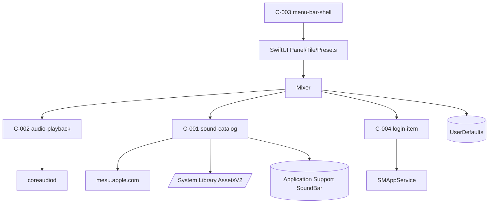

# System Architecture Document

## Architectural Style

**Single-process macOS app, một observable state owner.** `Mixer` (`@MainActor`, `ObservableObject`) giữ toàn bộ state và là mặt duy nhất UI nói chuyện; `Engine` bọc audio; SwiftUI vẽ panel; AppKit giữ shell.

Chọn vậy vì NFR-P01/P03 (≤ 1.5% CPU, ≤ 25 MB) không chịu được layer thừa, và constraint "toàn bộ trong `main.swift`, không dependency" loại mọi style cần nhiều module.

## System Overview

### Components

| ID | Component | Boundary / Architectural notes |
| --- | --- | --- |
| C-001 | sound-catalog | Biên I/O duy nhất ra mạng và filesystem; async, mọi lỗi nuốt mềm, trả `[URL]` cho engine |
| C-002 | audio-playback | Một `AVAudioEngine` cộng N `AVAudioPlayerNode`; `@MainActor`, không biết gì về UI hay persistence |
| C-003 | menu-bar-shell | `NSStatusItem` + `NSPopover` + `CALayer`; AppKit duy nhất lộ ra, host SwiftUI qua `NSHostingController` |
| C-004 | login-item | Bọc `SMAppService`, đọc lại `status` sau mỗi call thay vì tin kết quả trả về |

## Tech Stack

| Layer | Technology | Lý do chọn |
| --- | --- | --- |
| UI | SwiftUI (panel) cộng AppKit (status item, popover, CALayer) | SwiftUI gọn cho grid/slider; AppKit vì status item và icon layer không có API SwiftUI tương đương đạt NFR-P02 |
| Audio | AVFoundation (`AVAudioEngine`) | Mixing nhiều node trong một pipeline — API duy nhất đạt NFR-P01/P05 |
| Asset | `URLSession` + `PropertyListSerialization` + `/usr/bin/ditto` | Catalog Apple là plist XML; Foundation không có unzip nên phải mượn `ditto` |
| Persistence | `UserDefaults` cộng thư mục Application Support | State là vài chục byte scalar; thêm DB là nợ không đổi lấy gì (NFR-SE02) |
| Login | `ServiceManagement` (`SMAppService`) | API duy nhất còn được hỗ trợ trên macOS 13+ |
| Build | `swiftc -O -parse-as-library` + `build.sh` + ad-hoc codesign | Không Xcode project, không dependency — constraint |
| Distribution | Homebrew tap, build-from-source | Gatekeeper không thấy file quarantined nên chữ ký ad-hoc là đủ |

## Cross-Cutting Concerns

- **Authentication & Authorization:** không có — không tài khoản, không server. Quyền duy nhất xin hệ thống là login item qua `SMAppService`, và trạng thái luôn đọc lại từ OS chứ không cache kết quả call.
- **Error Handling:** fail mềm, degrade từng phần. Catalog lỗi → catalog rỗng, app vẫn mở; file hỏng → sound đó bị bỏ qua, các sound khác vẫn chạy; download fail → progress clear, tile trở về trạng thái chưa tải. Không retry tự động; lần tương tác sau là lần thử lại. Không có đường crash ngoài `precondition` trong self-check.
- **Logging & Monitoring:** `NSLog` cho đúng các lỗi im lặng không thấy được trên UI (hiện chỉ login item). Không telemetry, không crash reporter — NFR-SE01.
- **Caching:** audio tải về nằm trong Application Support, giữ vĩnh viễn; bản `/System/Library/AssetsV2` của Apple được tái dùng trước khi tải (NFR-A02). Trong bộ nhớ, `downloaded: Set<String>` được precompute để view body không stat filesystem (NFR-P04). Catalog **không** cache — fetch lại mỗi lần mở app.

## Inter-Service Communication

Một process duy nhất, không có service nội bộ. Các biên ngoài:

| From | To | Method | Protocol | Notes |
| --- | --- | --- | --- | --- |
| sound-catalog | mesu.apple.com | async | HTTPS GET | Catalog plist và asset zip; lỗi thì degrade, không retry |
| sound-catalog | `/usr/bin/ditto` | sync | subprocess | Giải nén; chờ `waitUntilExit`, chạy off main thread |
| audio-playback | coreaudiod | sync | AVFoundation IPC | Một pipeline duy nhất cho mọi sound |
| login-item | `SMAppService` | sync | XPC | Ghi rồi đọc lại `status` |

## Infrastructure Overview

Không có infrastructure. Một "môi trường" duy nhất: máy của người dùng. Artifact là `SoundBar.app` dựng tại chỗ bằng `./build.sh`, phân phối qua Homebrew tap `quannh287/tap/soundbar`. Không CI, không staging; `./soundbar --list` là cổng kiểm tra duy nhất trước khi tag.

## Architectural Guardrails

- GUARD-001: Một `AVAudioEngine` cho mọi sound. Không tạo engine hay pipeline riêng mỗi sound — CPU của `coreaudiod` scale theo số pipeline.
- GUARD-002: Không animate menu bar icon bằng cách gán lại `button.image` theo timer. Animation phải do Core Animation chạy trên `CALayer`.
- GUARD-003: `body` của SwiftUI view không được chạm filesystem, mạng, hay subprocess. Mọi thứ view cần phải đã nằm sẵn trong `@Published`.
- GUARD-004: Mọi state của `Mixer`/`Engine` sống trên `@MainActor`; callback từ `URLSession` hay AVAudio phải hop qua `Task { @MainActor }`.
- GUARD-005: Mạng chỉ đi tới `mesu.apple.com`. Không thêm endpoint, không telemetry, không analytics, không SDK bên thứ ba.
- GUARD-006: Không thêm dependency ngoài Apple framework, không thêm file nguồn ngoài `main.swift` và `tools/`. Mọi thứ phải build được bằng một lệnh `swiftc`.
- GUARD-007: Mọi I/O ngoài (catalog, download, unzip, `SMAppService`) phải fail mềm. Không `try!`, không force unwrap trên dữ liệu ngoài; app luôn dùng được với những gì đã tải.
- GUARD-008: Trạng thái do OS giữ (login item) phải đọc lại sau khi ghi, không suy ra từ kết quả call.
- GUARD-009: Preset built-in bất biến. Mọi thao tác ghi chỉ chạm preset người dùng trong `UserDefaults`.
- GUARD-010: Thay đổi logic không-UI phải kèm assert trong `check()`. `./soundbar --list` là test harness duy nhất và phải xanh trước khi tag.

## ADR Log

| ID | Decision | Status | Context & Rationale | Consequences |
| --- | --- | --- | --- | --- |
| ADR-001 | Tự phát audio thay vì drive ComfortSounds engine của Apple | accepted | Không có API công khai để điều khiển engine kia, và nó chỉ cho bật một sound | Không đồng bộ với toggle System Settings; hai bên có thể phát cùng lúc |
| ADR-002 | Một `AVAudioEngine` với N player node | accepted | Đo thấy CPU của `coreaudiod` scale theo số pipeline, không theo số sound | Mọi sound dùng chung mixer node; master volume là `mainMixerNode.outputVolume` |
| ADR-003 | Icon chạy bằng `CABasicAnimation` trên `CALayer` | accepted | Gán `button.image` theo timer tốn 2.5% một core, hơn cả decode audio | Phải tự quản `item.length` vì variable-length item không có image sẽ co lại và clip layer |
| ADR-004 | Single-file Swift, `swiftc` cộng `build.sh`, không Xcode project | accepted | App nhỏ; Xcode project là file sinh tự động ồn ào trong diff, dependency là bề mặt tấn công | Không có test framework; `check()` tự viết gánh toàn bộ phần kiểm tra |
| ADR-005 | Phân phối qua Homebrew build-from-source, ký ad-hoc | accepted | Notarize cần Developer ID trả phí; build tại máy nên không có quarantine | Người dùng cần toolchain Swift; `brew upgrade` không thay được bản đang chạy nên cần F-008 |
| ADR-006 | Lấy asset từ catalog MobileAsset công khai, ưu tiên bản `/System/Library/AssetsV2` | accepted | Không được redistribute audio của Apple; bản hệ thống đã có thì tải lại là lãng phí | Phụ thuộc endpoint không có hợp đồng — Apple đổi schema là mất khả năng tải sound mới |
| ADR-007 | Giải nén bằng `/usr/bin/ditto` | accepted | Foundation không có unzip; thêm thư viện zip vi phạm "không dependency" | Có một subprocess trong đường download; phải chờ `waitUntilExit` |
| ADR-008 | `UserDefaults` là store duy nhất | accepted | State là mix, master và vài preset — tổng vài trăm byte | Không migration, không schema; preset hỏng chỉ sửa được bằng `defaults delete` |
| ADR-009 | Shuffle các variation thay vì loop một file | accepted | Apple ship mỗi sound thành nhiều biến thể hoán đổi được; loop một file nghe rõ chỗ nối | Luôn phải queue sẵn ít nhất 2 file mỗi node để chỗ nối không hở |
