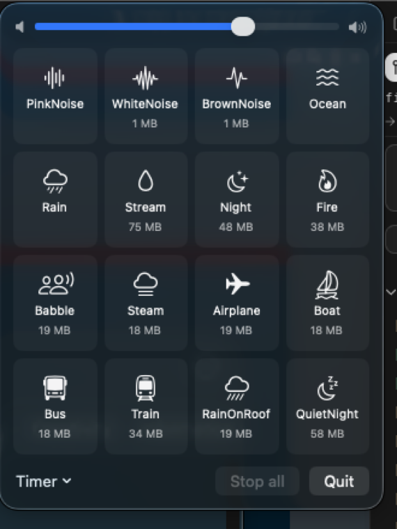

# SoundBar

A macOS menu bar app that pins one window, dims everything else, and times how long
you actually stayed on it — with Apple's Background Sounds playing underneath.



## Install

```sh
brew install quannh287/tap/soundbar
open "$(brew --prefix)/opt/soundbar/SoundBar.app"
```

Requires macOS 13+. To update, run `brew update && brew upgrade soundbar` and open the
app again — the new copy retires the old one on launch.

## Focus

Open the panel, pick a window, pick a length, and start. Everything else on every
display dims or blurs; the pinned window stays sharp.

- **Dimmed windows stay live.** The overlay ignores clicks, so a build or an agent
  session in the background is still readable and usable.
- **A shove when you drift.** Stay on another window past the grace period (5, 15 or
  30 seconds) and the dim jolts, while the pinned window flashes its outline.
- **Add a second window** to keep something beside the pinned one without a warning.
- **Peek** lifts the dim for 10 seconds.
- **Pomodoro** runs block → break → block on its own: a 5-minute break after each
  block, 15 after every fourth. Breaks are undimmed and not counted as focus.
- **Full screen while focusing** puts the pinned window in macOS full screen for the
  session and takes it back out at the end.
- **Daily total** and a seven-day strip, stored on your machine and nowhere else.

## Sounds

- **Mix** several sounds at once, with per-sound volume and a master.
- **Presets** — six built in (Deep Work, Cafe, Cozy, Sleep, Night, Flight), plus your
  own: save the current mix from the `+` chip, right-click to update, rename or delete.
- **Auto** changes the pairing every 5, 15, 30 or 60 minutes with a crossfade.
- **Timer** mutes after 30 or 60 minutes, independent of the focus timer.
- **Downloads on demand** from Apple, reusing the system's copy when it has one.
- **Open at Login**, and your mix resumes on launch.

## Permissions

None are required. Two are optional:

- **Screen Recording** shows real window titles in the list instead of app names.
- **Accessibility** is needed only for "Full screen while focusing". Switch it on under
  System Settings › Privacy & Security › Accessibility, and again after every upgrade.

## Cost

Measured with `top` and `footprint` on Apple silicon, three displays attached:

| | CPU | RAM |
|---|---|---|
| Idle, panel never opened | 0% | 14 MB |
| After the panel has been opened once | 0% | 43 MB |
| Focus session: three overlays, 10 Hz tracking, preset playing | ~3% | 44 MB |
| Playing two sounds, panel closed | ~1.2% | 50 MB |

Nothing is polled while idle: the tracking timer exists only during a session.

## Limits

- **Windows, not tabs.** A browser is pinned as a whole window.
- **No dim in full screen.** A full-screen window has no dim and no visible shove on
  its display; drifting is still counted in the log.
- **Screenshots and screen shares are dimmed too.**
- **A minimised pinned window looks closed** to the app; both dim everything.

## Build

```sh
swift test          # pure logic
./build.sh          # -> SoundBar.app
./soundbar --list   # smoke check, needs network
```

A Swift package with no dependencies and no Xcode project. `Sources/FocusKit` holds
the app (`Focus/`, `Sound/`, `UI/`); `Sources/focusbar` is the entry point.

## More

- [Design notes](docs/design-notes.md) — why it works this way, CPU and RAM cost, and
  the projects it learned from.
- [Focus analytics](docs/focus-analytics.md) — what each session logs (Vietnamese).
- [DESIGN.md](DESIGN.md) — the visual rules.

Sounds are Apple's own Background Sounds assets. MIT licensed.
