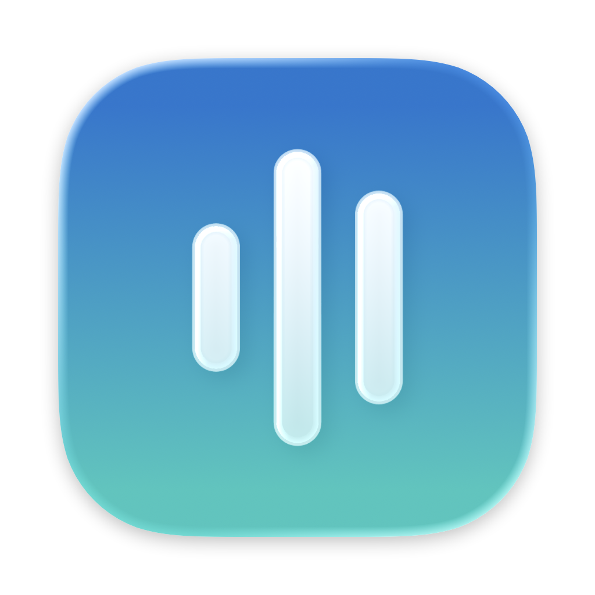

# SoundBar

A macOS menu bar mixer for Apple's built-in Background Sounds.

Layer any of the 16 sounds Apple ships with Accessibility > Audio > Background Sounds,
each with its own volume. Sounds the system has not downloaded yet are fetched from
Apple's MobileAsset catalog on first use.


## Build

```sh
./build.sh      # -> SoundBar.app
./soundbar --list   # self-check: catalog parse + local asset lookup
```

Requires macOS 13+ and a Swift toolchain. No Xcode project, no dependencies.

## What it does

- **Mix** several sounds at once, per-sound volume plus a master.
- **Download on demand** from `mesu.apple.com`, reusing Apple's own copy under
  `/System/Library/AssetsV2` when the system already has it.
- **Shuffle**, because Apple ships each sound as interchangeable variations —
  looping one file has an audible seam.
- **Presets** — six built in (Deep Work, Cafe, Cozy, Sleep, Night, Flight), plus your own:
  save the current mix from the `+` chip; right-click one of yours to update it to the
  current mix, rename it, or delete it. Built-ins cannot be overwritten, only copied.
- **Animated menu bar icon** — equaliser bars while playing, run by Core Animation
  rather than a timer, so they cost no CPU.
- **Timer** to mute after 30 or 60 minutes.
- **Open at Login**, via `SMAppService`.
- Your mix persists and resumes on launch.

It plays the audio itself rather than driving Apple's ComfortSounds engine, so it is
independent of the System Settings toggle. The two do not stay in sync.

## Cost

Measured with `top`, three sounds playing, on Apple silicon:

| | SoundBar | coreaudiod | RAM |
|---|---|---|---|
| Playing, three sounds | 1.2% | 2.0% | 17 MB |

RAM is `phys_footprint`, which is what Activity Monitor shows; `ps` reports ~40 MB RSS
because it counts shared framework pages.

Reassigning the status item's image on a timer cost 2.5% of a core on its own — more than
decoding the audio — whether the frames were drawn live or prepared in advance. The bars
are `CALayer`s under a repeating `CABasicAnimation` instead, so the compositor runs them
and the app does nothing per frame.

## Layout

Everything is in `main.swift`. The icon is generated by `tools/makeicon.swift` — run it,
pipe the PNG through `sips`/`iconutil`, and commit the resulting `AppIcon.icns`. Downloaded sounds land in
`~/Library/Application Support/SoundBar/`.

## Install

```sh
brew install quannh287/tap/soundbar
open "$(brew --prefix)/opt/soundbar/SoundBar.app"
```

Homebrew builds from source on your machine, so the ad-hoc signature is enough and
Gatekeeper never sees a quarantined download.

### Update

```sh
brew update && brew upgrade soundbar
```

Homebrew replaces the bundle on disk but cannot touch the copy already running. Just open
the new one — it retires the old instance on launch, so the two never play at once. With
**Open at Login** on, a logout or reboot does the same thing.

Check what you have against what the tap offers:

```sh
brew info soundbar | head -3
```

## License

MIT
